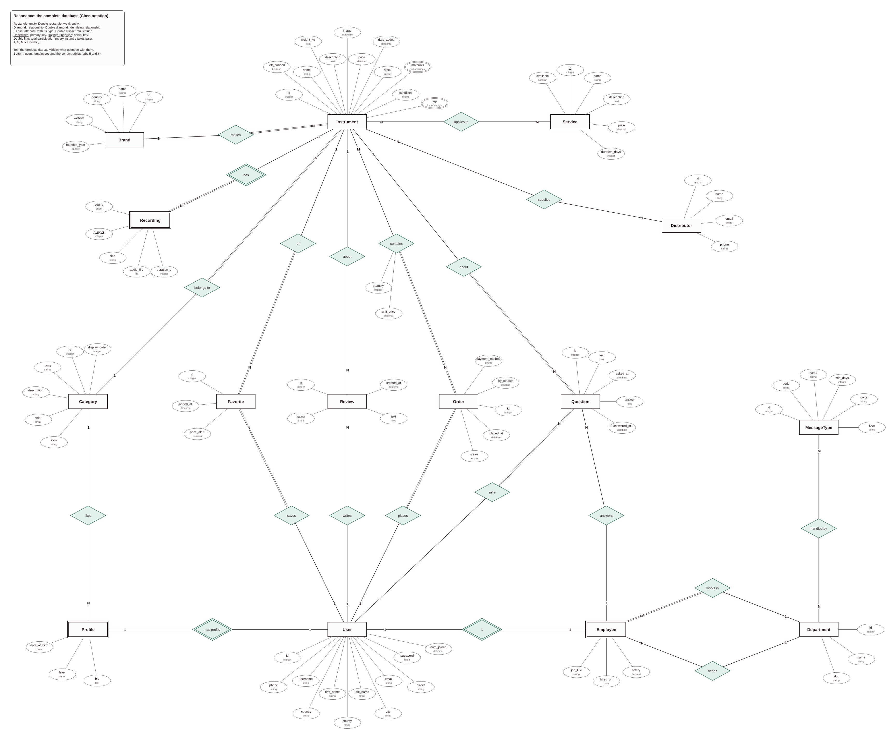

# Resonance

An online shop for musical instruments, built with Django and PostgreSQL. Every instrument gets a product page with its specifications, recordings of how it sounds, and (coming next) an interactive 3D model.

Built step by step as a university web development project.

## What's there so far

- A product catalogue with a filter form for every column (price range, brand, condition, dates, tags), a choice of 1 to 3 columns, and filtering that updates the list without reloading the page
- Product pages with recordings to play and random suggestions from the same category
- Category pages with their own colour and icon, and an Instrument categories menu built from the database
- Accounts: sign-up with a delivery address and an optional profile, a login that can last a day, a profile page, and pages to change the details or the password
- A contact form checked on the server, which saves each message as a JSON file by department, with a staff page to read them
- Sixteen related models: the catalogue (instruments, categories, brands, distributors, services, recordings), users and their profiles, employees, departments and contact message types, orders and the instruments in them, reviews, favourites and questions
- Data rules enforced twice: by Django with readable messages, and by PostgreSQL `CHECK` constraints
- A customised admin in the shop's colours, with search, filters and CSV and JSON export
- A visit log kept by middleware, with a filterable `/log` page
- Batch scripts that back up the database as `INSERT` commands and load a backup back
- Tests for the pages, forms, accounts and model rules

## Run it locally

Requirements: Python 3.12 or newer, and Docker (PostgreSQL runs in a container).

```
python -m venv .venv
.venv\Scripts\Activate.ps1          (Windows; on macOS and Linux: source .venv/bin/activate)
pip install -r requirements.txt
python genereaza_env.py             (writes .env with random secrets and an admin login)
docker compose up -d                (starts PostgreSQL and creates the database user)
python manage.py migrate
python manage.py createsuperuser --noinput
python manage.py incarca_date       (optional: sample instruments, brands, categories...)
python date_exemplu/genereaza_inserturi.py   (optional: SQL for 50 more random instruments)
python manage.py runserver
```

The shop is at http://127.0.0.1:8000/ and the admin at http://127.0.0.1:8000/admin/ (the login is in `.env`). Run the tests with `python manage.py test instruments`.

## Database



The diagram uses Chen notation; [`docs/diagrama-bd-utilizatori.drawio`](docs/diagrama-bd-utilizatori.drawio) opens in draw.io. The first version, with the catalogue only, is [`docs/diagrama-bd.png`](docs/diagrama-bd.png).