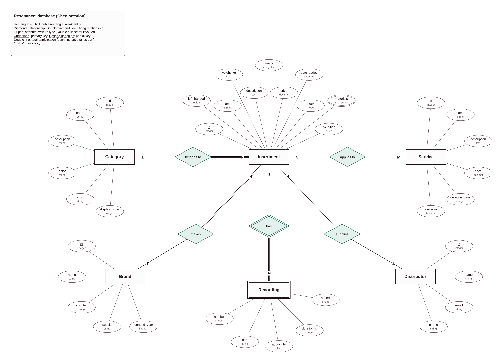

# Resonance

An online shop for musical instruments, built with Django and PostgreSQL. Every instrument gets a product page with its specifications, recordings of how it sounds, and (coming next) an interactive 3D model.

Built step by step as a university web development project.

## What's there so far

- Shop pages built from template inheritance, with a CSS-only dropdown menu that folds on phones
- A catalogue of six related models: instruments, categories, brands, distributors, services, and recordings, the weak entity
- Data rules enforced twice: by Django with readable messages, and by PostgreSQL `CHECK` constraints
- A customised admin for entering and browsing the catalogue
- A visit log kept by middleware, with a filterable `/log` page
- Tests for the pages and the model rules

## Run it locally

Requirements: Python 3.12 or newer, and Docker (PostgreSQL runs in a container).

```
python -m venv .venv
.venv\Scripts\Activate.ps1          (Windows; on macOS and Linux: source .venv/bin/activate)
pip install -r requirements.txt
python genereaza_env.py             (writes .env with random secrets and an admin login)
docker compose up -d                (starts PostgreSQL and creates the database user)
python manage.py migrate
python manage.py createsuperuser --noinput
python manage.py incarca_date       (optional: sample instruments, brands, categories...)
python manage.py runserver
```

The shop is at http://127.0.0.1:8000/ and the admin at http://127.0.0.1:8000/admin/ (the login is in `.env`). Run the tests with `python manage.py test instruments`.

## Database


