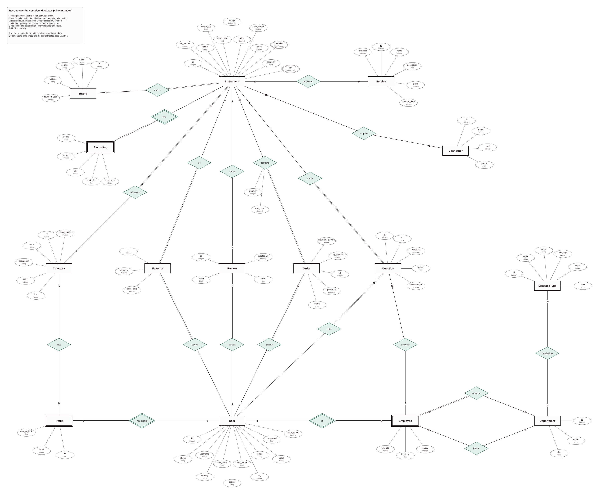

# Lab 6: users, orders, and backing up the database

## 1. Apply it

The steps must run in this order. Lab 6 replaces Django's own `User` with the site's (`instruments.User`), and Django only allows that from a project's very first migration: its permission and admin-log tables point to the user table from the start. So the migrations start over from a new `0001_initial.py`, and the database is emptied and rebuilt. The backup keeps the data through that.

In PowerShell, in `D:\Resonance`, with Docker Desktop running:

```
# 1. Remove the old migrations (0001 to 0005): lab 6 starts them over
Remove-Item instruments\migrations\0*.py
Remove-Item -Recurse instruments\migrations\__pycache__ -ErrorAction SilentlyContinue
```

2. Extract the zip over the project. It brings the new `0001_initial.py` and `0002_date_contact.py`.

```
# 3. Back up the data, while the database still has it
.\backup.bat

# 4. Delete the database and make an empty one
docker compose down -v
docker compose up -d

# 5. Create every table from the new migrations
python manage.py migrate

# 6. Put the data back (Tab completes the file name)
.\restaurare.bat backups\backup_2026-11-19_14-00-00.sql

# 7. A new admin account, from the DJANGO_SUPERUSER_ values in .env
python manage.py createsuperuser --noinput

# 8. Check
python manage.py test instruments
```

- Step 3 should say about 121 rows: your instruments, categories, brands, departments and so on.
- Step 7 is needed because the old admin account was in Django's `auth_user` table, which isn't one of the site's tables and is replaced by `instruments_user`. The new admin account has no address yet; the admin asks for one the first time you edit that account.
- The tests should end with `OK` (72 tests).

If step 5 or 6 goes wrong, the backup file is safe: repeat steps 4 to 6.

### Commit

`git add .` also records the deleted migrations.

```
git add .
git commit -m "Laborator 6: utilizatori, profil, comenzi, backup al bazei de date"
git push
```

## 2. The backup (the task done first)

### backup.bat

It runs `pg_dump`, PostgreSQL's backup program, inside the database container, so nothing needs installing on Windows. It writes `backups\backup_<date>_<time>.sql`, a file of `INSERT` commands, one per row.

| Option | Why |
|---|---|
| `--data-only` | only the rows. The tables come from the migrations, so the backup still loads after the models change |
| `--inserts --column-inserts` | `INSERT INTO table (column, ...) VALUES (...)` instead of PostgreSQL's `COPY` format. Naming the columns lets a backup load into a table that has gained a column since |
| `--table "instruments_*"` | only the site's own tables, the ones `models.py` defines (Django names them `app_model`): 20 of them since this lab, including the link tables of the many-to-many relationships. Each table's id counter comes along too. Django's own tables (sessions, permissions, applied migrations) are made by `migrate` |

The file's name has the date and time from PowerShell, because `%date%` in a batch file is written differently on every Windows language. The `backups` folder is in `.gitignore`: a backup holds the users' emails and password hashes.

Since this lab, pg_dump prints a warning about *circular foreign-key constraints*: a department's head is an employee, and an employee works in a department, so neither table can be loaded entirely before the other. The restore below handles it.

### restaurare.bat

`restaurare.bat backups\<file>.sql` runs `psql` in the container, all in one transaction:

1. It empties every `instruments_` table and resets its id counter. Without this, the departments and message types that `migrate` creates (`0002_date_contact.py`, so that a new database has them) would clash with the backup's copies, and the backup's version, the one with the department heads, would be lost. Emptying the users also empties the admin's history (`django_admin_log`), whose rows point to users.
2. It runs the backup's commands.

Django creates its foreign keys as `DEFERRABLE INITIALLY DEFERRED`, so PostgreSQL checks them when the transaction ends, not after each row. That's why the order of the rows doesn't matter, not even for a department and its head.

If any row fails, nothing changes. Loading the same backup twice gives the same result.

## 3. Utilizatori

The completed diagram is `docs/diagrama-bd-utilizatori.png` (the draw.io file next to it can be edited). The lab 3 diagram, `docs/diagrama-bd.png`, stays as it was.



The diagram has three layers:
- **top**: the products, from lab 3
- **middle**: what users do with them: favourites, reviews, orders and questions
- **bottom**: the users, employees, and the contact tables of lab 5

### User

Django's `AbstractUser` brings `id`, `username`, `first_name`, `last_name`, `email`, `password`, `date_joined`, and a few flags for the admin (`is_staff`, `is_superuser`, `is_active`, `last_login`). The password is never stored as typed: Django keeps a salted PBKDF2 hash of it. `email` is made required and unique here, and it's stored in lowercase, so Ana@ and ana@ are one account.

The five columns added by the site are the delivery address, which every account needs:

| Column | What it holds | Checked by |
|---|---|---|
| `phone` | for the courier | `telefon_valid`: 0721 000 000, or + and the country code |
| `country` | Romania by default | `majuscula_si_litere`: a capital letter, then only letters, spaces and hyphens |
| `county` | the county, or a region outside Romania | in Romania, `judet_roman`: one of the 41 counties or București, with or without diacritics, saved spelled properly ("iasi" becomes Iași) |
| `city` | town or city | `majuscula_si_litere` |
| `street` | street and number, building, apartment | `strada_cu_numar`: a name and a number |

The checks are in `validatori.py` and are attached to the model's columns, so the sign-up form, the details form and the admin all apply them.

### Profile: the optional details

A one-to-one relationship with User. The profile's primary key is its user's id, so a user can't have two profiles. That's why the diagram draws it as a weak entity: it's identified through its user.

| Column | What it holds |
|---|---|
| `date_of_birth` | not in the future, not before 1900 |
| `level` | beginner, intermediate, advanced or professional |
| `favorite_category` | a foreign key to Category (the "likes" relationship): the instruments they like most |
| `bio` | "About you", 500 characters at most |

A user has a row here only if they filled in at least one of these. Sign up without them and the Profile table gets nothing.

### Employee

A one-to-one relationship with User, holding only what being an employee adds: the name, email and the rest stay in the user's row. Its primary key is also its user's id.

| Column | What it holds |
|---|---|
| `department` | where they work: a foreign key to the Department table from lab 5 |
| `job_title` | for example Luthier |
| `hired_on` | the date they started |
| `salary` | gross, per month; must be more than 0 |

**Department** gained `head`: an employee, or empty. `Department.clean()` checks that the head works in that department.

### Order

| Column | What it holds |
|---|---|
| `user` | who placed it. A user with orders can't be deleted (`PROTECT`): orders are kept for the accounts |
| `placed_at` | date and time the order was placed |
| `status` | placed, paid, shipped, delivered or cancelled (a database rule refuses anything else) |
| `by_courier` | ticked: delivered by courier; unticked: collected from the shop |
| `payment_method` | card, cash on delivery or bank transfer. A database rule allows cash on delivery only with a courier |
| `products` | the instruments: a many-to-many relationship through `OrderItem` |

An order has several instruments and an instrument is in several orders, so the link between them is a table of its own, `OrderItem`, with two more columns:
- `quantity`: at least 1
- `unit_price`: the price when the order was placed, so later price changes don't alter old orders. `Order.total()` adds up quantity × unit price.

An instrument appears at most once per order: two of the same instrument are one row with quantity 2.

### The three other entities

| Entity | Columns | Rules |
|---|---|---|
| **Review** | `rating` (1 to 5), `text`, `created_at`, and who wrote it about which instrument | one review per user and instrument |
| **Favorite** | `added_at`, `price_alert` (email them when the price drops), and whose list, which instrument | an instrument is on a list once |
| **Question** | `text`, `asked_at`, `answer`, `answered_at`, `answered_by` (an employee), and who asked about which instrument | an answer has a date and a date has an answer |

## 4. Where each requirement is

| Requirement | Where |
|---|---|
| Backup script, done first | `backup.bat`, and `restaurare.bat` to load a backup (section 2) |
| Models for the diagram, then reset and migrate | `models.py`, from "Lab 6"; `settings.AUTH_USER_MODEL = "instruments.User"`; migrations `0001_initial.py`, `0002_date_contact.py` |
| Sign-up form with every field, Django's included | `/inregistrare`, `InregistrareForm` in `forms.py` (based on Django's `UserCreationForm`, which checks the password and stores its hash) |
| Validation on at least 3 of the 5 added fields | all 5, see the User table above |
| The profile's fields in the sign-up form, optional; no Profile row if they're all empty | the "Your profile" group; `ParteComunaCont.salveaza_profil()` |
| Login form, "keep me logged in" for a day | `/login`, `LoginForm` and `views_conturi.autentificare`: ticked, `request.session.set_expiry(86400)` (a cookie that lasts a day, even after the browser closes); unticked, `set_expiry(0)` (deleted when the browser closes) |
| Logout, shown only to a logged-in user | the menu's account entry (`` in `meniu.html`). It's a button that sends a form with POST: a plain link could log people out when a browser loads it in advance |
| After login, a page with the user's data and profile, taken from the session | the login saves them in `request.session["cont"]`; `/profil` reads them from there |
| Links to change the password, and the other details including the profile | `/profil/parola` (`ParolaForm`); `/profil/date` (`DateContForm`), which creates the Profile row if there's none, or updates it |

Two details:
- After the password changes, `update_session_auth_hash` keeps the user logged in in this browser. Other browsers they were logged in on are logged out.
- Emptying every profile field in "Your details" deletes the Profile row. That keeps the rule from sign-up: a row exists only when it has something in it.

The session is kept in the `django_session` table as JSON, so the dates are saved there as text.

## 5. For the presentation

- **Sign up without a profile**: in the admin, open Profiles: no row for the new user. Sign up another user and choose a level: now there's a row.
- **Validation**: sign up with phone `123`, county `Atlantis`, or street `Strada Florilor` (no number). Each field says what's wrong. County `iasi` is accepted and saved as Iași.
- **Keep me logged in**: log in with the box ticked, then open the browser's developer tools (F12) → Application → Cookies. `sessionid` expires a day later. Log out and in without the box: it expires at "Session", when the browser closes. The profile page says the same in words.
- **From the session**: the profile page ends with "saved in your session at 14:05". Change your name in the admin and reload the profile: it still shows the old name, because it comes from the session. Save "Your details" and it's updated.
- **Logout**: the menu shows your name; Log out is in its list. When you're logged out, the menu shows Log in and Sign up instead.
- **Backup**: run `.\backup.bat` and open the file: one `INSERT` per row, users included.
